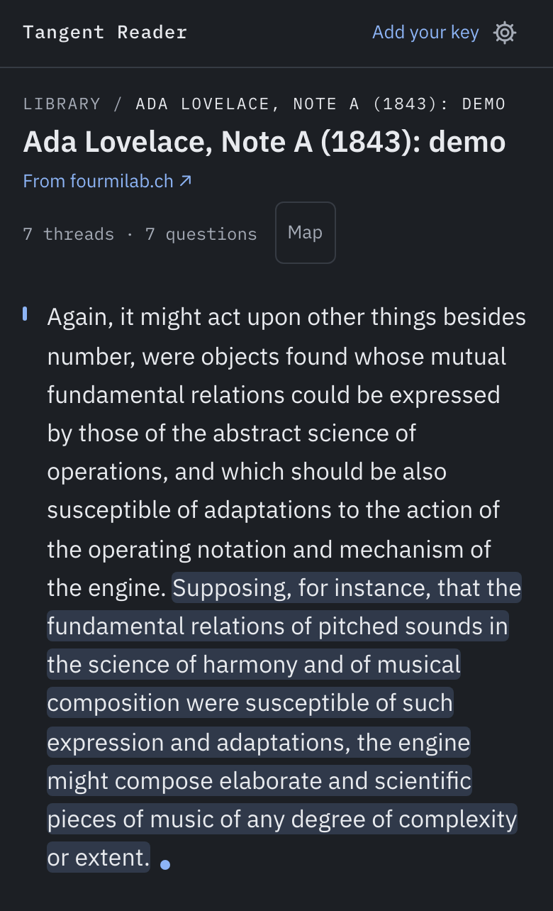
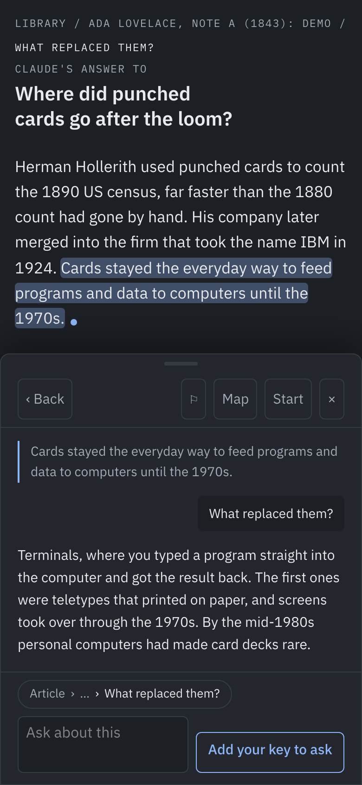
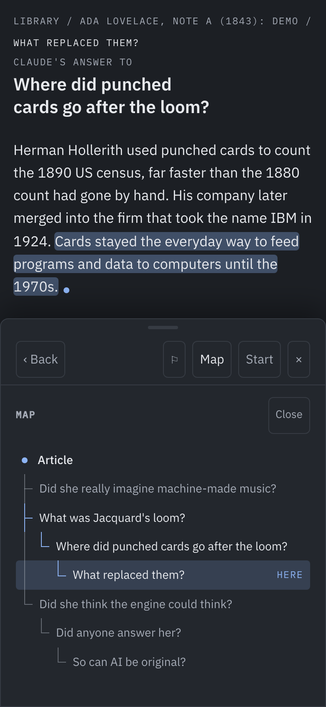
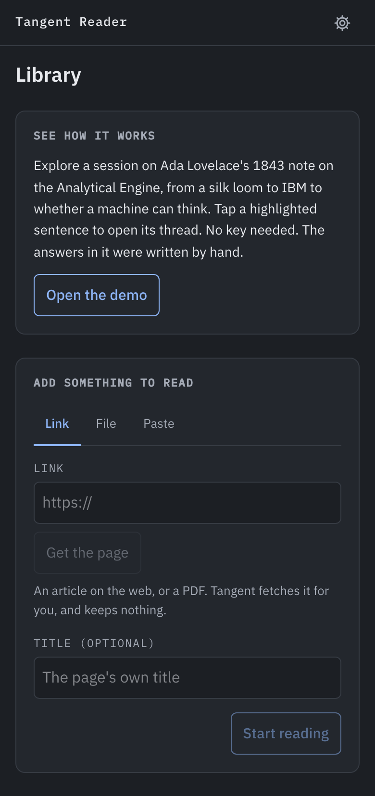

# Tangent Reader

Go down every rabbit hole without losing your place. A chat that branches instead of scrolling.
Ask Claude about any sentence you're reading, then go deeper from any point in the answer.

**[Try it](https://tangent-reader.tangent-reader.workers.dev)**: open the demo, no key needed.

<p>
  
  
  
  
</p>

## Why

When you ask a chatbot about something you're reading, the answer lands in a chat panel off to
the side. Ask a follow-up about one line of that answer and the thread drifts. A few follow-ups
later you've lost the paragraph you started on.

Tangent Reader keeps every conversation anchored to the exact sentence it came from, so going
three levels deep never means losing your place. The demo goes from Lovelace's 1843 note on a
silk loom to IBM to whether a machine can think, and one tap takes you home.

## What it does

- **Bring something to read:** paste text, give a link, or open a PDF, Markdown or text file.
- **Tap a sentence:** ask Claude about it. Answers stream in and are saved as they arrive.
- **Tap a sentence in an answer:** branch a tangent about exactly that sentence, as deep as you
  like. Every move is a page address, so your browser's Back is Tangent's Back.
- **The map:** the whole session as a tree. Flag threads to come back to; the library picks
  up exactly where you left off.
- **Look it up:** a per-question switch for Anthropic's web search, off by default since it costs
  more.
- **Cost, out in the open:** every call's tokens and cost are saved and shown, with an optional
  monthly limit.

## Your key and your data

Tangent Reader is local-first and uses your own Anthropic API key. A key in the page makes script
injection the main threat, and the page is built around that.

- **A strict Content Security Policy** lets scripts load only from this site and the page talk
  only to itself and Anthropic. Everything an article or answer contains is shown as text, never
  as HTML.
- **Your key stays in your browser** and goes only to `api.anthropic.com`. It is never in a
  backup, the call log or anything the page stores. Make a key just for this, in a Console
  workspace with a spend limit.
- **Your reading stays on your device,** in IndexedDB. There are no accounts and no analytics.
  Export and import a JSON backup to move devices.
- **The one server piece** is a small Cloudflare Worker that fetches a link's page for you,
  because browsers can't fetch most pages themselves. It keeps nothing and refuses private
  addresses, checked after DNS and again after every redirect.

More in [PRIVACY.md](PRIVACY.md) and [SECURITY.md](SECURITY.md).

## How it's built

- React, TypeScript and Tailwind on Vite. Dexie over IndexedDB for the store.
- The Anthropic TypeScript SDK, called straight from the browser. Sonnet 5.5 by default, Haiku 5.5
  in Settings.
- **The article is the cached prefix** of every call, for an hour, so every thread on one article
  reuses it. Eight questions over an hour on a long article, with pauses between them, cost about
  a quarter of what the 5-minute cache would.
- **Every rule is a pure, tested function:** the store's integrity rules, sentence splitting,
  navigation, cost math and the spending guard.
- One Cloudflare Worker serves the built page and the link fetch from one origin.

## Quality

- **Unit tests** (Vitest): 400+ tests, including the store with `fake-indexeddb`, migrations,
  streaming with a fake client through every failure, and pinned prompts that show any change to
  what is sent.
- **End to end** (Playwright, on an iPhone screen): every flow, plus the built page run under
  its real CSP, so a policy that would break the page fails CI.
- **Evals:** prompt injection, grounding and answer shape, run against the real API on made-up
  cases. See [evals/](evals/README.md) for what passes, what doesn't, and what's next.
- CI runs the typecheck, both test suites, the build and a dependency audit on every PR. No test
  calls the real API.

## Run it yourself

You need Node 24 and pnpm.

```sh
pnpm install
pnpm dev          # http://127.0.0.1:5190
pnpm test         # unit tests
pnpm e2e          # end-to-end tests
```

Add your Anthropic API key in the app to ask Claude. The demo opens without one.

To host it, deploy the Worker with Wrangler: `pnpm build && pnpm dlx wrangler@4.149.0 deploy`
(`wrangler.jsonc` holds the config).

## Read more

- [Design notes](docs/design.md): the problem, the decisions and trade-offs, and how each part works.
- [Contributing](CONTRIBUTING.md)

## License

MIT. The demo text is Ada Lovelace's Note A (1843), in the public domain.
